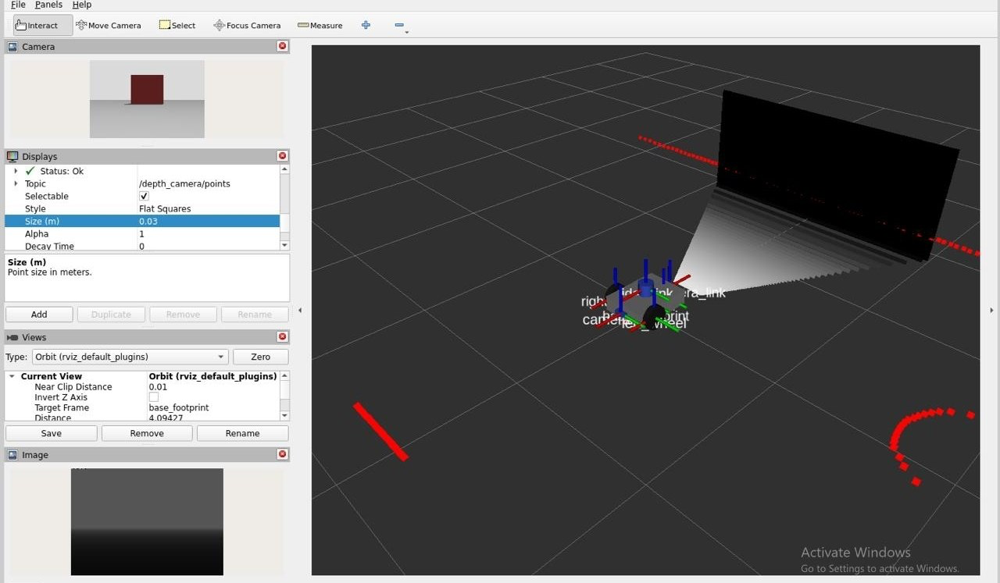
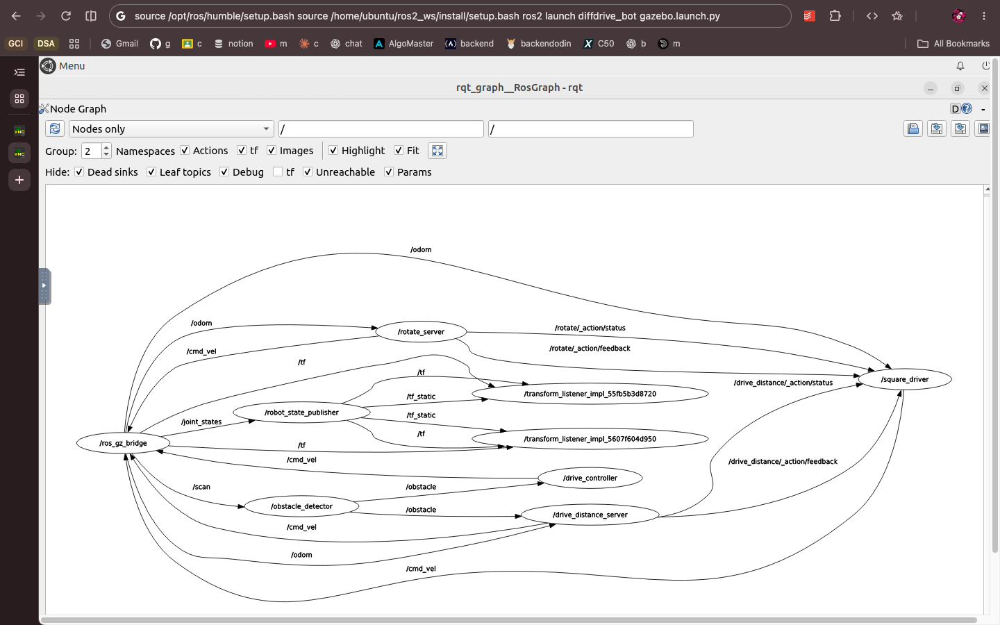

Name: zenebu melaku
ID: UGR/6058/16

# Lab 1: ROS 2 Robot Simulation

This project extends a differential-drive robot with a rear depth camera and an IMU, then uses ROS 2
topics, services, custom interfaces, and actions to control the robot in Gazebo.

## Challenge

The lab challenge is to complete the following work in the four packages in this project:

1. **Add sensors:** Extend the robot URDF with a rear-facing depth camera and a chassis-mounted IMU.
   Configure Gazebo and the ROS-Gazebo bridge so the depth image, point cloud, camera info, and IMU
   are available on their ROS topics.
2. **React to obstacles:** Implement `turn_away` to read `/obstacle` and publish `/cmd_vel`, driving
   forward when the path is clear and turning away when an obstacle is too close.
3. **Add live parameters:** Make the forward and turn speeds configurable, and use updated parameter
   values as the node runs.
4. **Define and publish a message:** Create `RobotStatus` with the robot state and obstacle distance,
   and publish it as the obstacle node processes messages.
5. **Add services:** Provide `/turn_away_enable` to enable or stop obstacle driving, and a custom
   `/set_turn_speed` service that validates and updates the turn speed.
6. **Create a rotation action:** Implement `/rotate` using odometry to measure the requested angle,
   provide feedback and a result, and stop safely on cancellation.
7. **Drive a square:** Implement `square_driver` and `square.launch.py` to sequence four distance
   goals and four quarter-turn goals. The launch file should start the simulation and both action
   nodes; the robot should return close to its starting point.

## Packages

- `diffdrive_bot`: the supplied robot, extended with a rear depth camera and an IMU.
- `lab_interfaces`: the supplied obstacle message, speed service, and drive-distance action.
- `my_robot_interfaces`: the `RobotStatus` message, `SetTurnSpeed` service, and `Rotate` action.
- `my_robot_nodes`: `turn_away`, `rotate_server`, `square_driver`, and the square launch file.

## Screenshots

### Depth camera and point cloud

RViz view showing the robot, depth image, and point cloud from `/depth_camera/points`.



### ROS node graph

`rqt_graph` view of the ROS nodes and connections while the square-driving setup is running.



## Requirements

The course environment is Ubuntu 22.04, ROS 2 Humble, and Gazebo Harmonic with its ROS packages
(`ros-humble-ros-gzharmonic`). The build also needs the dependencies declared in the four package
manifests, including `colcon`, `xacro`, RViz, `rqt_graph`, and the ROS-Gazebo bridge.

## Build

Place this folder directly under the `src` directory of a ROS 2 workspace. Build only these packages
so identically named packages elsewhere in the course repository are not selected:

```bash
source /opt/ros/humble/setup.bash
cd ~/ros2_ws
colcon build --symlink-install --base-paths src/lab1_exercise
source install/setup.bash
```

In the Docker desktop used for this exercise, the workspace is `/home/ubuntu/ros2_ws`. Open a
terminal in the desktop and use:

```bash
source /opt/ros/humble/setup.bash
cd /home/ubuntu/ros2_ws
colcon build --symlink-install --base-paths src/lab1_exercise
source install/setup.bash
```

The `tiryoh/ros2-desktop-vnc:humble` image used during development initially provided Gazebo Classic,
not the Gazebo Harmonic required by this lab. Gazebo Harmonic's ROS packages and `gz-sim8-cli` were
installed in that container before the exercise was built and run. A fresh container based on that
image may need the same Gazebo setup before the commands below work.

## Run and check each step

Use a sourced terminal for each command. For separate terminals, source the ROS and workspace setup
files in each terminal before running ROS commands.

### Step 1: Depth camera and IMU

For the RViz sensor and frame check:

```bash
ros2 launch diffdrive_bot display.launch.py
```

For the live depth image and point cloud:

```bash
ros2 launch diffdrive_bot gazebo.launch.py
```

The expected ROS topics are `/depth_camera/image`, `/depth_camera/points`,
`/depth_camera/camera_info`, and `/imu`. Check the IMU with `ros2 topic hz /imu` and
`ros2 topic echo /imu`. The RViz screenshot above shows the sensor displays.

### Steps 2–5: Obstacle behavior, parameters, message, and services

Start the base simulation in one terminal:

```bash
ros2 launch diffdrive_bot control.launch.py
```

In another terminal, start the obstacle node:

```bash
ros2 run my_robot_nodes turn_away
```

Enable the node from a sourced terminal:

```bash
ros2 service call /turn_away_enable std_srvs/srv/SetBool "{data: true}"
```

Check the custom message and parameter behavior:

```bash
ros2 interface show my_robot_interfaces/msg/RobotStatus
ros2 topic echo /robot_status
ros2 param list /turn_away
ros2 param set /turn_away forward_speed 0.4
```

Check that the turn-speed service accepts a valid speed and rejects one above its configured
maximum:

```bash
ros2 service call /set_turn_speed my_robot_interfaces/srv/SetTurnSpeed "{turn_speed: 1.0}"
ros2 service call /set_turn_speed my_robot_interfaces/srv/SetTurnSpeed "{turn_speed: 3.0}"
ros2 service call /turn_away_enable std_srvs/srv/SetBool "{data: false}"
```

### Step 6: Rotation action server

With the base simulation running, start the server in a separate terminal:

```bash
ros2 run my_robot_nodes rotate_server
```

Send a quarter-turn goal from another terminal:

```bash
ros2 action send_goal --feedback /rotate my_robot_interfaces/action/Rotate "{angle: 1.57}"
```

### Step 7: Square action client and launch file

The launch file starts the simulation, rotation server, and square driver:

```bash
ros2 launch my_robot_nodes square.launch.py side_length:=0.8
```

The robot should complete four sides and turns, returning close to its starting position. To inspect
the graph while it runs, start `rqt_graph` in another sourced terminal:

```bash
ros2 run rqt_graph rqt_graph
```

The graph screenshot above shows the running node connections.

## Notes

The course environment is Ubuntu 22.04 with ROS 2 Humble and Gazebo Harmonic. The Docker desktop image
used during development initially provided Gazebo Classic, so Gazebo Harmonic's ROS packages and
`gz-sim8-cli` were installed in that container. A fresh container based on the same image may need
the Gazebo Harmonic packages installed before running the simulation.

### What did not work and important notes

Development was done on a MacBook Air (MacBookAir7,2) with a 1.8 GHz dual-core Intel Core i5, 8 GB
RAM, and macOS 12.7.6. ROS 2 and Gazebo ran in Docker Desktop, configured with 4 CPUs and about
3.8 GiB of container memory. There was about 9.6 GiB of free disk space at the last check. This
matters because the Ubuntu ROS/Gazebo GUI ran inside a resource-limited virtualized environment,
rather than natively on the Mac.

The following issues occurred during setup and testing:

- The ROS desktop Docker image initially had Gazebo Classic, but this lab requires Gazebo Harmonic.
  The Harmonic ROS packages and `gz-sim8-cli` were installed in the running container; a fresh
  container from that image may need this setup again.
- Building a separate custom GUI image failed intermittently when package downloads and DNS lookups
  timed out. The existing ROS desktop image was used instead.
- Gazebo startup and robot spawning were slow with software rendering. The first square attempt sent
  its action goal before odometry was available. The driver was updated to wait for odometry, and a
  later 0.8 m square run completed successfully.
- The depth image initially appeared black in RViz. The final screenshot shows the depth view and
  the point-cloud display reporting `Status: Ok`; the depth topics were observed publishing.
- Later, the `ros_gui` container stopped with exit code 137. Docker reported `OOMKilled=false`, so
  the exact cause is unknown. The simulation could not be rechecked after the container stopped.

The successful build and square run were verified before the container stopped. The included
screenshots are saved in `screenshots/`. For a repeatable check, use Ubuntu 22.04, ROS 2 Humble, and
Gazebo Harmonic with the packages listed above.
